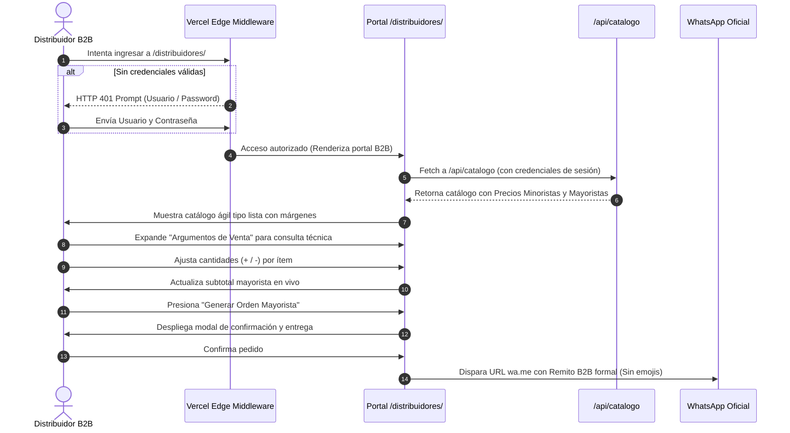

# PRD: Portal de Distribuidores B2B (Suplementos Mendoza)
**Documento de Requerimientos de Producto (Product Requirements Document)**  
**Agencia:** WAFLERS  
**Autor:** Agente Orquestador (Lead Architect & Project Manager)  
**Versión:** 1.0 (Especificación B2B)  
**Estado:** Listo para Delegación y Ejecución  
**Fecha:** Octubre 2026  
**Dominio Base:** `suplementosmendoza.com.ar`  
**Ruta del Portal:** `/distribuidores/`  
**Canal Oficial de Pedidos B2B:** WhatsApp Oficial (+54 9 261 336-4201 / `+5492613364201`)  

---

## 1. Resumen Ejecutivo y Objetivos Estratégicos

### 1.1 Visión del Producto
El **Portal de Distribuidores B2B** es un entorno privado, ágil y de alta densidad operativa diseñado específicamente para la red comercial de **Suplementos Mendoza** (dueños de gimnasios, boxes de crossfit, preparadores físicos, centros de estética y revendedores independientes del Gran Mendoza).

A diferencia de la landing page pública B2C (enfocada en branding visual, educación al consumidor final y fotos de impacto), el portal B2B opera como una **consola de abastecimiento y ventas (Quick-Order Desk + Sales Pitch Tool)**. Permite a los distribuidores:
1. **Reabastecerse a velocidad récord:** Formato de lista tabular/compacta sin fotos gigantes, con selección directa de cantidades y visualización simultánea de **Precio Público** y **Precio Mayorista**.
2. **Vender más y mejor en el mostrador:** Un panel desplegable integrado con argumentos comerciales y beneficios biológicos clave para cada producto, sirviendo de "chuleta" o ayuda-memoria técnico frente al cliente final.
3. **Checkout Directo Sin Fricción:** Generación automatizada de la orden de compra a precio mayorista enviada directamente al WhatsApp administrativo, identificando al distribuidor autenticado, sin emojis y con formato de remito corporativo.

### 1.2 Objetivos de Negocio y KPIs
* **Tiempo de Carga de Pedido B2B:** Reducir el tiempo necesario para emitir un pedido recurrente de 10 ítems a menos de 45 segundos.
* **Margen Transparente:** Visibilidad inmediata de rentabilidad estimada para incentivar ticket promedio más alto en el distribuidor.
* **Blindaje Total de Datos Sensibles:** 0% de filtración de costos mayoristas hacia usuarios no autenticados o motores de búsqueda.
* **Cero Fricción en Compra:** Sin montos mínimos de compra forzados (apoyando la rotación ágil de inventario de gimnasios de barrio).

---

## 2. Jerarquía Creativa (Fronteras del Proyecto)

### 2.1 Restricciones del Cliente (Innegociables)
* **Canal de Despacho:** Los pedidos se procesan y confirman exclusivamente por WhatsApp al número oficial `+5492613364201`.
* **Políticas Comerciales:** Sin compras mínimas obligatorias para distribuidores validados.
* **Esquema de Precios:** Precios minoristas y mayoristas gobernados centralizadamente desde la planilla maestra de Google Sheets DB.
* **Tono de Comunicación B2B:** Directo, profesional, sin emojis en las comunicaciones de remito/orden, enfocado en rentabilidad, pureza y rotación.

### 2.2 Libertades WAFLERS (Estándares de Calidad Asumidos)
* **Arquitectura de Software:** Despliegue sobre Vercel Edge Network, protegiendo la ruta `/distribuidores` mediante Edge Middleware con HTTP Basic Auth / Session Tokens validados contra Variables de Entorno.
* **Diseño UI/UX B2B:** Modo oscuro de alta densidad (Dark Carbon `#08090A` y bordes sutiles del Design System v3.0), optimizado para navegación táctil vertical en smartphones desde el mostrador del gimnasio.
* **Control de Indexación:** Exclusión estricta de motores de búsqueda (`noindex, nofollow`, cabecera `X-Robots-Tag: noindex`).

---

## 3. Personas de Usuario y Casos de Uso B2B

### 3.1 Perfiles de Usuario
1. **El Dueño / Encargado de Gimnasio o Box:**
   * *Contexto:* Se le acaba la Creatina o la Proteína un jueves a la tarde. Necesita reponer stock urgente para el fin de semana.
   * *Acción:* Entra desde el celular a `/distribuidores`, pone sus credenciales, ajusta cantidades con los botones `+ / -`, revisa el total a pagar a costo mayorista y dispara la orden a WhatsApp en un clic.
2. **El Entrenador Personal / Nutricionista Aliado:**
   * *Contexto:* Un alumno le pregunta qué creatina tomar o para qué sirve la Beta-Alanina.
   * *Acción:* Abre el portal desde su móvil, expande el accordion de **Argumentos de Venta** del producto en cuestión, lee el beneficio diferencial y le vende el suplemento con seguridad técnica y convicción.

---

## 4. Arquitectura de Información y Estructura de Directorios

### 4.1 Árbol de Directorios Definitivo
```
suplementos.mendoza/
├── api/
│   └── catalogo.js              # Endpoint Serverless: entrega B2C (público) o B2B (con mayorista si hay sesión)
├── distribuidores/              # [NUEVO DIRECTORIO B2B]
│   ├── index.html               # Estructura del portal de pedidos y ventas B2B
│   └── app.js                   # Lógica de renderizado ágil, estado de carrito B2B y checkout WhatsApp
├── middleware.js                # Vercel Edge Middleware (Bloqueo de acceso y validación de credenciales)
├── assets/                      # Recursos compartidos (logos, favicons, iconos)
├── index.html                   # Landing page pública B2C existente
├── main.js                      # Lógica del frontend B2C existente
└── PRD_distribuidores.md        # Este documento maestro de requerimientos
```

### 4.2 Mapa de Navegación del Portal `/distribuidores/`
```
[ /distribuidores/ ]  <─── [ Protegido por Vercel Edge Middleware ]
├── 1. Top Bar B2B
│   ├── Indicador de Sesión Activa ("Distribuidor: {usuario}")
│   ├── Botón de Cierre de Sesión / Logout
│   └── Badge de Envíos Mayoristas Gran Mendoza
├── 2. Header de Control & Búsqueda
│   ├── Buscador predictivo en tiempo real (por nombre de producto o categoría)
│   ├── Filtros rápidos por Categoría (Rendimiento, Salud, Alimentación)
│   └── Resumen flotante de Compra (Total Ítems | Subtotal Mayorista | Botón flotante Pedido)
├── 3. Quick-Order Catalog (Lista Tabular Compacta)
│   └── Fila por Producto / Presentación:
│       ├── Nombre de Producto & Presentación
│       ├── Badge de Stock en tiempo real (OK / Agotado)
│       ├── Precios duales: [P. Público (Tachado/Referencia)] vs [P. Mayorista (Destacado)]
│       ├── Margen de Ganancia calculado en vivo ($ y %)
│       ├── Selector Rápido de Cantidad (- / Input / +)
│       └── Trigger de Accordion ("💡 Argumentos de Venta")
│           └── Panel colapsable: Función Principal, Beneficio Clave, Objeción Típica
└── 4. Drawer / Modal de Confirmación B2B
    ├── Lista condensada de ítems seleccionados
    ├── Total final a abonar (Precios Mayoristas)
    ├── Selector de método de entrega (Retiro / Envío)
    ├── Campo para aclaraciones o notas del pedido
    └── Botón de Disparo: "Enviar Pedido Mayorista por WhatsApp" (Sin emojis)
```

---

## 5. Requerimientos Funcionales Detallados

### 5.1 Seguridad y Vercel Edge Middleware (`middleware.js`)
* **Interceptación de Rutas:** El archivo `middleware.js` debe ejecutarse en el Edge de Vercel y proteger todas las peticiones hacia `/distribuidores` y sus sub-recursos.
* **Mecanismo de Autenticación:** 
  * Implementación mediante **HTTP Basic Authentication** estándar o verificación de cookie de sesión cifrada.
  * Si la cabecera `Authorization` no está presente o es inválida, responder inmediatamente con código HTTP `401 Unauthorized` y cabecera `WWW-Authenticate: Basic realm="Portal Privado de Distribuidores - Suplementos Mendoza"`.
* **Variables de Entorno en Vercel:**
  * `B2B_AUTH_USER`: Nombre de usuario autorizado.
  * `B2B_AUTH_PASS`: Contraseña maestra autorizada.
* **Credenciales de Desarrollo y Testing:**
  * **Usuario Master:** `master`
  * **Contraseña Master:** `admin123`
* **Exclusión de Indexación:** Inyectar en todas las respuestas de `/distribuidores` la cabecera HTTP `X-Robots-Tag: noindex, nofollow, noarchive`.

### 5.2 Capa de Datos y Adaptación de `/api/catalogo.js`
* **Comportamiento Dual:**
  * **Petición Pública B2C:** Si la petición a `/api/catalogo` no contiene credenciales de autorización válidas, la función continúa sanitizando y eliminando de raíz la propiedad `mayorista`.
  * **Petición Autenticada B2B:** Si la petición incluye las credenciales de autorización validadas (vía cabecera `Authorization` o cookie propagada por el middleware), el endpoint retorna el JSON completo conservando intactas las propiedades:
    * `producto` (Nombre y variante)
    * `minorista` (Precio de venta al público sugerido)
    * `mayorista` (Precio de costo para el distribuidor)
    * `stock` (Estado de inventario en Google Sheets: `OK` / `NO`)

### 5.3 Interfaz del Catálogo B2B (Quick-Order List)
* **Formato de Lista Compacta:** 
  * Cero fotos grandes que ralenticen la carga o dispersen la atención en pantalla.
  * Layout enfocado en tabla/filas con densidad de información alta (ergonomía tipo software de inventario / ERP-Lite).
* **Columnas / Datos Obligatorios por Fila:**
  1. **Producto & Presentación:** Tipografía nítida con distinción clara entre presentación (ej: `Creatina 600g`, `Proteína Cookies 907g`).
  2. **Disponibilidad:** Badge sobrio (Verde `En Stock` / Rojo `Agotado`). Si el producto no tiene stock, los controles de cantidad quedan bloqueados.
  3. **Display de Precios Dual:**
     * **P. Público:** Precio de venta sugerido al mostrador (valor minorista).
     * **P. Mayorista:** Costo neto para el distribuidor (valor destacado con mayor jerarquía tipográfica).
     * **Margen Estimado:** Indicador visual de ganancia por unidad (ej: `Margen: +$14.000 / 40%`).
  4. **Controles de Cantidad Integrados:** Botones ergonómicos táctiles `[-]` y `[+]` junto a un input numérico que permite tipeo manual o incremento por clic, actualizando el subtotal en tiempo real.

### 5.4 Herramienta de Ventas: Accordion de Argumentos Comerciales
Debajo de cada ítem del catálogo existirá un botón interactivo colapsable: **"Argumentos de Venta"**. Al hacer clic, se despliega una ficha técnica condensada con información lista para repetirle al cliente final:
* **Función Biológica Principal:** Qué hace el compuesto en el cuerpo (ej: resíntesis de ATP y potencia muscular pura sin relleno).
* **Beneficio Clave:** Por qué este producto supera a las marcas masivas de farmacia o suplementos baratos (ej: pureza analizada por Proyecto Suplementos, sin maltodextrina agregada).
* **Dosis Recomendada / Ingesta:** Protocolo rápido de toma para transmitir seguridad al cliente (ej: 5g diarios continuos con cualquier líquido).

### 5.5 Checkout B2B y Serializador de Pedidos a WhatsApp
* **Sin Mínimos de Compra:** El distribuidor puede encargar desde 1 unidad de prueba hasta un lote mayorista completo.
* **Barra de Resumen Fija (Sticky Bottom Bar):**
  * Contador total de unidades en el pedido.
  * Monto total a abonar a precio mayorista.
  * Botón de acción destacado: **"Generar Orden Mayorista"**.
* **Modal de Cierre Rápido:**
  * Confirmación de datos de entrega: Retiro coordinado o Envío a local/gimnasio.
  * Dirección del punto de entrega.
  * Observaciones o notas adicionales.
* **Serialización a WhatsApp Sobria (SIN EMOJIS):**
  A diferencia del checkout B2C (que usa iconos y estilo lúdico), el mensaje B2B debe tener formato formal de **Remito / Orden de Compra**:
  ```text
  ORDEN DE COMPRA B2B - DISTRIBUIDORES
  Suplementos Mendoza
  --------------------------------------------------
  Distribuidor: [Usuario de sesión activa, ej: master]
  Fecha: [DD/MM/AAAA - HH:mm]
  Entrega: [Envío a Gimnasio / Retiro Coordinado]
  Dirección: [San Martín 1234, Godoy Cruz]
  
  DETALLE DEL PEDIDO (PRECIOS MAYORISTAS):
  - 5x Creatina Monohidrato 600g: $175.000 (Costo unit: $35.000)
  - 3x Proteína Vegetal Cookies 907g: $102.000 (Costo unit: $34.000)
  - 2x Pre-Work Bosque 300g: $48.000 (Costo unit: $24.000)
  
  TOTAL A PAGAR: $325.000
  --------------------------------------------------
  Notas: Enviar factura B con el pedido.
  ```

---

## 6. Requerimientos de Diseño UI/UX (B2B Desk Edition)

* **Continuidad de Marca:** Respeto total de la paleta del `design-system.md` v3.0:
  * **Canvas:** `#08090A` (Carbon Mineral).
  * **Superficies:** `rgba(18, 20, 23, 0.85)` con bordes `border-white/[0.08]`.
  * **Acentos:** Azul Eléctrico (`#2563eb`) para rendimiento, Esmeralda (`#059669`) para salud y ámbar (`#d97706`) para alimentos.
* **Tipografías Oficiales:**
  * `Outfit` (Bold / SemiBold) para titulares de sección, cifras numéricas y totales.
  * `Lato` para etiquetas de variantes, descripciones de producto y argumentos de venta.
* **Ergonomía Táctil Móvil:** 
  * Los botones `+` y `-` deben contar con un área de contacto mínima de `44x44px` para evitar pulsaciones erróneas en pantallas de smartphones.
  * La barra flotante inferior no debe obstaculizar el scroll de los productos.

---

## 7. Flujo de Usuario B2B Paso a Paso



---

## 8. Stack Tecnológico & Consideraciones de Despliegue

* **Runtime de Middleware:** Vercel Edge Middleware (`@vercel/edge` estándar sin dependencias pesadas).
* **Frontend B2B:** HTML5 Semántico + Vanilla JavaScript modular (cero frameworks, carga instantánea en 3G/4G).
* **Estilos:** Tailwind CSS integrado respetando el Design System v3.0 existente.
* **Conexión de Datos:** Reutilización de la arquitectura Google Sheets DB vía `/api/catalogo.js`.
* **Variables de Entorno en Producción:**
  * `B2B_AUTH_USER` = Usuario asignado.
  * `B2B_AUTH_PASS` = Contraseña de alta entropía.

---

## 9. Matriz de Delegación de Tareas (WAFLERS Handover)

Esta matriz es vinculante e instruye a cada rol de la agencia para la construcción del portal B2B:

```yaml
delegacion_waflers:
  fase: "Construcción Portal B2B Distribuidores"
  proyecto: "Suplementos Mendoza"
  documento_rector: "PRD_distribuidores.md"

  copywriter:
    responsabilidad: "Redacción Comercial y Técnica de Apoyo"
    entregables:
      - "Argumentos de venta concisos por cada uno de los 14 productos del catálogo (Función principal, Beneficio clave diferencial, Dosis recomendada)."
      - "Plantilla de texto del Remito B2B formal para WhatsApp (verificación estricta de CERO EMOJIS)."
      - "Microcopys de la interfaz B2B (labels de margen de ganancia, avisos de stock y confirmación)."
    restricciones: "Prohibido utilizar tono infantil o emojis en los mensajes B2B. Enfoque quirúrgico y comercial."

  disenador:
    responsabilidad: "Diseño UI/UX de Alta Densidad (Quick-Order)"
    entregables:
      - "Definición del layout tipo lista/tabla para escritorio y móvil."
      - "Especificación de componentes: fila de producto compacta, selector +/- de 44px, badge de margen de ganancia y drawer colapsable de argumentos de venta."
      - "Barra flotante inferior de resumen de pedido con cálculo en vivo."
    restricciones: "Prohibido usar fotos de producto grandes en la vista principal de la lista. Fondo Carbon #08090A obligatorio."

  programador:
    responsabilidad: "Implementación Técnica y Seguridad"
    entregables:
      - "Creación de middleware.js en la raíz del proyecto para interceptar y autenticar /distribuidores con credenciales maestras (master / admin123)."
      - "Actualización de /api/catalogo.js para exponer la columna mayorista únicamente bajo autenticación válida."
      - "Creación de la carpeta /distribuidores/ con su index.html y app.js funcional."
      - "Lógica reactiva de cálculo de subtotales mayoristas, buscador instantáneo y serializador formal de WhatsApp."
    restricciones: "Garantizar que ningún usuario público no autenticado pueda acceder a los precios mayoristas inspeccionando el código o las respuestas de red."

  qa:
    responsabilidad: "Auditoría Estática, Seguridad y Consistencia"
    entregables:
      - "Verificación de bloqueo del middleware (prueba de accesos no autorizados 401)."
      - "Comprobación estricta de no-indexación (etiquetas robots y headers X-Robots-Tag)."
      - "Auditoría de consistencia entre precios de Google Sheets, margen visualizado y total enviado a WhatsApp."
    restricciones: "Validación estática de código y lógica sin ejecución de navegadores ocultos."
```
